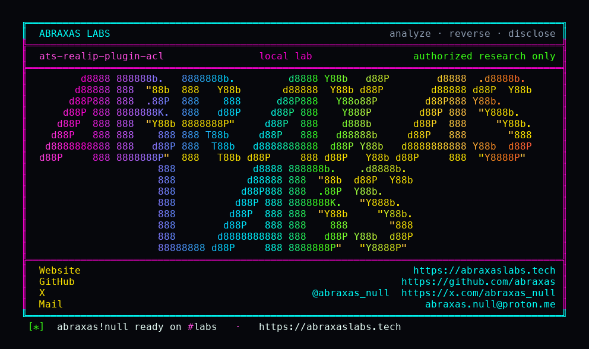

<p align="center">
  
</p>

<p align="center">
  <a href="https://abraxaslabs.tech"><strong>abraxaslabs.tech</strong></a>
  &nbsp;·&nbsp;
  <a href="https://github.com/abraxas">github.com/abraxas</a>
  &nbsp;·&nbsp;
  <a href="https://x.com/abraxas_null">@abraxas_null</a>
  &nbsp;·&nbsp;
  <a href="mailto:abraxas.null@proton.me">abraxas.null@proton.me</a>
  &nbsp;·&nbsp;
  <a href="https://github.com/abraxas/ats-realip-plugin-acl">ats-realip-plugin-acl</a>
</p>

# ats-realip-plugin-acl

**Class:** Privilege leftover
**Reach:** Remote

**Apache Traffic Server** `10.2.0` (`b1df7334`) - Apache Software Foundation

experimental realip plus the documented `acl.subjects: PLUGIN` fail-opens remap `@src_ip`. If realip does not call `TSHttpTxnVerifiedAddrSet`, `_verified_addr` stays `AF_UNSPEC`. PLUGIN subject is never nullptr, so PEER fallback never runs. `ats_is_ip` is false, `@src_ip` is skipped, `ip_matches` stays true. A remap allow-list matches the untrusted client.

Default `acl.subjects` is `PEER`. realip is not in stock `plugin.config`. Session `ip_allow.yaml` never reads PLUGIN. Classic X-Forwarded-For-from-anyone is closed (`trustedAddress` required; header must be a single `inet_pton` address).

| | |
|---|---|
| ID | no CVE yet |
| Class | **Privilege leftover** (remap ACL fail-open) |
| Reach | **Remote** (unauth HTTP from outside `trustedAddress`) |
| CWE | [CWE-863](https://cwe.mitre.org/data/definitions/863.html) |
| CVSS | **High: 8.1** `CVSS:3.1/AV:N/AC:H/PR:N/UI:N/S:U/C:H/I:H/A:H` |
| Product | [Apache Traffic Server](https://github.com/apache/trafficserver) |
| Affected | **10.2.0** (`b1df7334b39a878971c376da849e8da4984918b6`) experimental realip + PLUGIN subjects |
| Auth | none. Client is **not** in `trustedAddress`. |
| License | [GNU Affero GPL v3.0](LICENSE) |
| Lab | `127.0.0.1:18770` only |

I pinned public tag [10.2.0](https://github.com/apache/trafficserver/releases/tag/10.2.0) peel [b1df7334](https://github.com/apache/trafficserver/commit/b1df7334b39a878971c376da849e8da4984918b6). The lab is a source-built `ats-10.2.0-lab:local` reverse proxy on loopback. CONTROL PEER 403. PLUGIN 200. Session PURGE still 403.

## What an attacker can do

Reach ATS with experimental `realip.so` loaded and `proxy.config.acl.subjects: PLUGIN` (or `PLUGIN,PEER`). Remap `@src_ip=10.0.0.0/8` allow. Connect from an address **outside** `trustedAddress`.

| Method | Sink | Privilege |
|---|---|---|
| HTTP from 172.x outside `trustedAddress` to remap `@src_ip=10.0.0.0/8` | realip skip `TSHttpTxnVerifiedAddrSet` ([`address_setter.cc:29-38`](https://github.com/apache/trafficserver/blob/b1df7334b39a878971c376da849e8da4984918b6/plugins/experimental/realip/address_setter.cc#L29-L38)); PLUGIN subject always present ([`UrlRewrite.cc:462-473`](https://github.com/apache/trafficserver/blob/b1df7334b39a878971c376da849e8da4984918b6/src/proxy/http/remap/UrlRewrite.cc#L462-L473)); skip `@src_ip` when `!ats_is_ip` (`:495-514`) | **Integrity (lab-proven):** remap ACL matches. Origin 200 `ATS-REALIP-PLUGIN-ACL-WITNESS`. CONTROL `acl.subjects=PEER` is 403. |
| Same plus `Client-IP: 10.1.2.3` from the untrusted peer | `simple.cc` `verify` false; header ignored | **Integrity (lab-proven):** still fail-open 200. Not a spoof of the verified address. |
| Same client `PURGE` | session `ip_allow.yaml` PEER | **Closed (lab-proven):** 403. PLUGIN never rewrites connection ACL. |
| Host without `@src_ip` | default map | **Closed (lab-proven):** body `DENIED`, no witness. |

**Lab-proven vs inferred:** PLUGIN 200, PEER 403, PURGE 403, denied map, untrusted header fail-open are lab. What the origin then grants is inferred from the remap that was supposed to be 10/8-only.

**Requires:** experimental `realip.so` plus `acl.subjects=PLUGIN` (or `PLUGIN,PEER`). Remap `@src_ip` allow-list. Not default.

## Adjacent surface that stays closed

| Surface | Lab |
|---|---|
| CONTROL `acl.subjects=PEER` | 403 on the same `@src_ip` map |
| Session `ip_allow.yaml` | attacker PURGE 403 |
| Map without `@src_ip` | `DENIED` |
| Empty `trustedAddress` | never verifies; still fail-open only when subjects is PLUGIN |
| Classic XFF-from-anyone | closed. Header must be a single `inet_pton` address from a trusted peer |
| SNI `ip_allow` | PEER/PROXY only; handshake is before HTTP headers |
| Default subjects `PEER` | leftover does not apply |

Not the classic "trust X-Forwarded-For from anyone" leftover. The leftover is the documented PLUGIN remap ACL path.

## Lab

```bash
python3 ats-realip-plugin-acl-Abraxas-Labs.py
```

or

```bash
cd lab
./run.sh
```

Loopback `127.0.0.1:18770` (origin `18771`). Compose project `ats-realip-plugin-acl`. Image `ats-10.2.0-lab:local`. Attacker sidecar 172.x. Witness `ATS-REALIP-PLUGIN-ACL-WITNESS`. Last line:

```
SUCCESS ats-realip-plugin-acl control-http=403 poc-http=200 purge-http=403 denied-http=200 spoof-http=200 trusted-http=200 ATS-REALIP-PLUGIN-ACL-WITNESS
```

## The fix

Treat PLUGIN as unavailable when `get_verified_client_addr` is `AF_UNSPEC` (or make the getter return nullptr, matching `TSHttpTxnVerifiedAddrGet`). Then PEER fallback runs. Do not skip `@src_ip` when the subject pointer is non-null but not an IP. Fail closed on an allow-list.

Until then, leave `acl.subjects` at `PEER` if you load realip only for logging. Do not set PLUGIN unless every client that can hit the remap is already a trusted proxy.

## References

- [github.com/apache/trafficserver](https://github.com/apache/trafficserver) tag [10.2.0](https://github.com/apache/trafficserver/releases/tag/10.2.0) (`b1df7334b39a878971c376da849e8da4984918b6`)
- [`plugins/experimental/realip/address_setter.cc`](https://github.com/apache/trafficserver/blob/b1df7334b39a878971c376da849e8da4984918b6/plugins/experimental/realip/address_setter.cc)
- [`src/proxy/http/remap/UrlRewrite.cc`](https://github.com/apache/trafficserver/blob/b1df7334b39a878971c376da849e8da4984918b6/src/proxy/http/remap/UrlRewrite.cc) `PerformACLFiltering`
- [`include/proxy/ProxyTransaction.h`](https://github.com/apache/trafficserver/blob/b1df7334b39a878971c376da849e8da4984918b6/include/proxy/ProxyTransaction.h) `get_verified_client_addr`
- [realip admin guide](https://docs.trafficserver.apache.org/en/latest/admin-guide/plugins/realip.en.html)
- [CWE-863](https://cwe.mitre.org/data/definitions/863.html)
